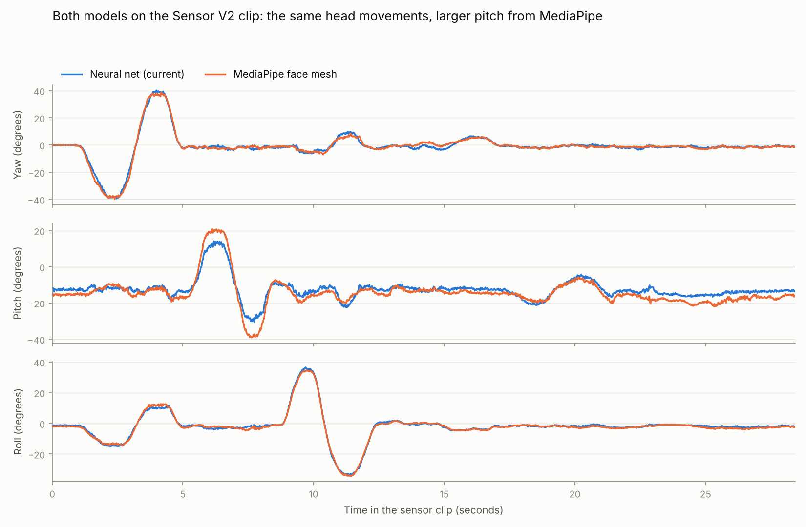

# MediaPipe face mesh prototype (branch `trackhat-mediapipe-prototype`)

An experimental second tracking model inside the neuralnet tracker, built to compare against the
current head-pose network. Branched from `trackhat-2026.1` at `12f6e2a` on 2026-11-13. **Not for release.**

## What it is
- Options > Tracker > **Tracking model**: `Neural net (default)` or `MediaPipe face mesh (experimental)`.
  It can be changed while tracking; the setting is `pose-backend` (0 / 1) in the `neuralnet-tracker` section.
- With MediaPipe selected the tracker runs Google's Face Landmarker models through the ONNX Runtime
  that is already shipped (no new library):
  1. `models/mediapipe-face-detector.onnx` (BlazeFace short range, 128x128) finds the face when there is no track.
  2. `models/mediapipe-face-landmarks.onnx` (Face Mesh V2, 256x256, 478 landmarks) runs every frame on a
     rotated patch around the face and says whether it still sees a face.
  3. MediaPipe's canonical face model is fitted to the landmarks (weighted Procrustes, the same 33 landmarks
     and weights as MediaPipe's face geometry module). That gives rotation, a head centre and a head size,
     which go through the tracker's existing 3D position, offset and preview code.
- Code: `tracker-neuralnet/facemesh.{h,cpp}` (both models and the fit), `facemesh_canonical.h` (generated),
  the `facemesh_` branches in `ftnoir_tracker_neuralnet.cpp`. The default model's code path is unchanged.
- Licence: models and canonical face data are Apache 2.0 (`3rdparty-notices/MEDIAPIPE.txt`; the Face Mesh V2
  model card states the licence). Regenerate with `scripts/trackhat/convert-mediapipe-model.sh` and
  `scripts/trackhat/make-facemesh-canonical.py`.

## Differences from the default model that the owner will notice
- **Internal Noise Filter does nothing** with MediaPipe: that filter needs the uncertainty the head-pose
  network outputs. Only Accela smooths the MediaPipe output.
- The preview shows the landmarks as cyan dots.
- It reports "no face" when much of the face is covered. The default model keeps guessing instead.
- It costs more CPU per frame (see below).

## Development aids added with it (environment variables)
- `OPENTRACK_VIDEO_FILE=<file>`: the tracker plays a video file at its frame rate instead of opening a camera,
  and tracking starts by itself. The file loops, unless a pose log is written. Verified on Linux only; on
  Windows it depends on what the OpenCV build can decode.
- `OPENTRACK_POSE_LOG=<csv>`: one line per frame (tracked, yaw, pitch, roll, x, y, z, inference ms, face
  position and size). With a video file, opentrack quits when the file ends.
- `OPENTRACK_POSE_BACKEND=neuralnet|mediapipe`: overrides the Tracking model setting.
- `OPENTRACK_VIDEO_FILE_SNAPSHOT=<dir>`: saves the main window with the video preview every 2 s.
- `OPENTRACK_VIDEO_FILE_SWITCH_MODEL=1`: switches the tracking model in the options every 6 s.
- `OPENTRACK_UI_SNAPSHOT` + `OPENTRACK_UI_SNAPSHOT_START` now work without a camera when a video file is given.

Example (Linux, as a non-root user, under Xvfb):

    OPENTRACK_VIDEO_FILE=clip.mp4 OPENTRACK_POSE_BACKEND=mediapipe OPENTRACK_POSE_LOG=mp.csv bin/opentrack

## What was measured (cloud Linux, 4 vCPU, 1 ONNX thread, 2026-11-13)
Clips: three public test videos from OpenCV's `opencv_extra` (`david`, `faceocc2`, `dudek`; ordinary visible-light
webcam footage, 320x240 to 720x480, 25 fps) and `dudek` darkened to 15% brightness with added noise.
The tracker converts everything to greyscale, so both models saw greyscale images. Both ran through the real app.

| Clip | Frames | Tracked, neural net | Tracked, MediaPipe | Typical angle difference between the two |
|---|---|---|---|---|
| david (starts in the dark) | 770 | 719 | 718 | 0.8-1.7 deg |
| faceocc2 (book held over the face) | 812 | 812 | 749 | 1.3-1.6 deg |
| dudek | 1145 | 1145 | 1142 | 0.7-1.7 deg |
| dudek, darkened | 1145 | 1140 | 1140 | 1.0-1.6 deg |

- "Typical" is the median per axis after removing the constant offset between the models (up to 2 deg; 5 deg
  pitch on faceocc2). The 90th percentile is 2-8 deg. Position agrees to about 0.5 cm sideways and 1-1.5 cm in depth.
- **Speed:** 12-13 ms per frame for MediaPipe against 4.5-5.5 ms for the neural net. At the sensor's 60 fps
  that leaves little headroom on a slow CPU with one thread.
- **Jitter** (frame-to-frame wobble of the raw output): MediaPipe is roughly 0.9-1.7x the neural net, depending on clip and axis. The
  comparison favours the neural net because its internal filter was on.
- On faceocc2 the neural net reported a pose on every frame, including a distance of 24 m at one point;
  MediaPipe dropped out while the face was covered.
- The C++ landmarks match Google's own MediaPipe Python package to about 0.5 px on these clips, and the fitted
  angles agree with its `facial_transformation_matrix` to 1-3 deg (Python comparison, not in the repo).
- Also checked: the unit test for the model fit passes at start-up; switching models while tracking works;
  the Tracker tab shows the new setting (UI snapshot).

## Sensor V2 clip (2026-11-14)
The owner supplied `SensorV2TestTrackingVIdeo.mp4`, filmed with the sensor: infrared, 640x480, about 58 fps,
1641 frames (28 s), one person with headphones turning, nodding, tilting and leaning in and out, with the
brightness changing. Not in the repo. Both models ran on it through the app (same cloud machine as above).

| | Neural net, internal filter on | Neural net, filter off | MediaPipe |
|---|---|---|---|
| Frames tracked | 1641 / 1641 | 1641 / 1641 | 1641 / 1641 |
| Time per frame, mean / 99th percentile | 4.5 / 7.8 ms | 4.5 / 7.7 ms | 11.5 / 15.6 ms |
| Frames slower than the 17.3 ms frame time | 0 | 3 | 10 |
| Wobble, yaw / pitch / roll (deg) | 0.14 / 0.21 / 0.10 | 0.24 / 0.37 / 0.17 | 0.25 / 0.37 / 0.17 |

- "Wobble" is what is left of the output after a 9-frame smoothing curve is subtracted (RMS over the clip). The
  four half-second stretches where the head was still give the same picture.
- **Raw steadiness is the same.** The neural net is only steadier with its internal filter, which MediaPipe
  cannot use yet.
- **Yaw and roll agree** (MediaPipe = 1.01x and 0.99x the neural net; typical difference 0.6 and 0.5 deg).
- **Pitch does not agree:** MediaPipe reports 1.32x the neural net's pitch (nod up 20 deg against 14, nod down
  -38 against -30). Google's own MediaPipe pose solver, run on the same frames in Python, gives a pitch span of
  60 deg, like the prototype's 60 and unlike the neural net's 45. There is no ground truth in the clip, so which
  is right is open; a clip with a known nod angle would settle it.
- Position agrees to 0.2 cm sideways, 0.4 cm up/down and 0.6 cm in depth (typical); MediaPipe reads depth 5% shorter.
- MediaPipe's face-presence score stayed high for the whole clip, and the landmarks match Google's Python
  package to 0.5 px on these infrared frames.
- The clip has yaw up to 40 deg, no glasses, no profile views, no face covering and one person.

## Not verified
- **Live use with the sensor.** One recorded sensor clip was tested (above); nothing ran with the sensor attached.
  The model card says the model was trained on smartphone camera images and does not mention infrared.
- Glasses, yaw beyond 40 deg, other people, other rooms and lighting.
- Windows: not built or run. CI builds this branch (`trackhat-*`); the MSVC result is unknown until it runs.
- 60 fps behaviour, CPU load on the owner's PC, and how it feels in a game.
- Head centre and size constants were fitted on the three clips above (about 2500 frames), not on the sensor.

## Next steps
1. Owner: install the CI build, switch the Tracking model while tracking with the sensor, compare.
2. More sensor clips: with glasses, turning further than 40 deg, and one with a known nod angle to settle
   the pitch question.
3. If it is worth keeping: landmark smoothing (MediaPipe uses a one-euro filter) or an uncertainty estimate so
   the internal filter works, and a look at the cost per frame (2 threads, or the smaller 192x192 model).
